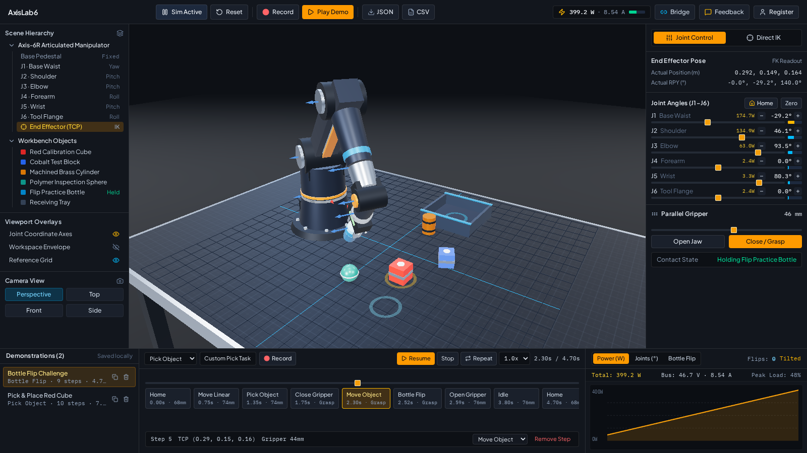
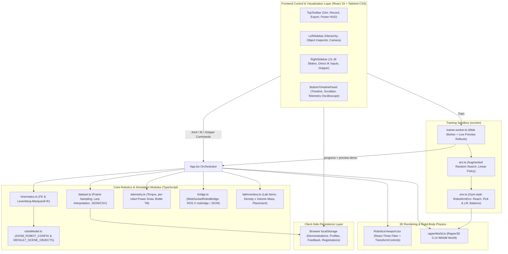
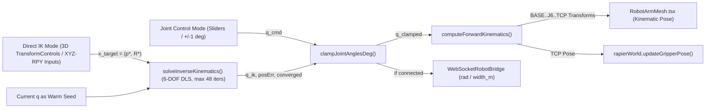
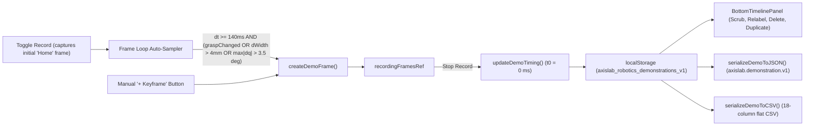
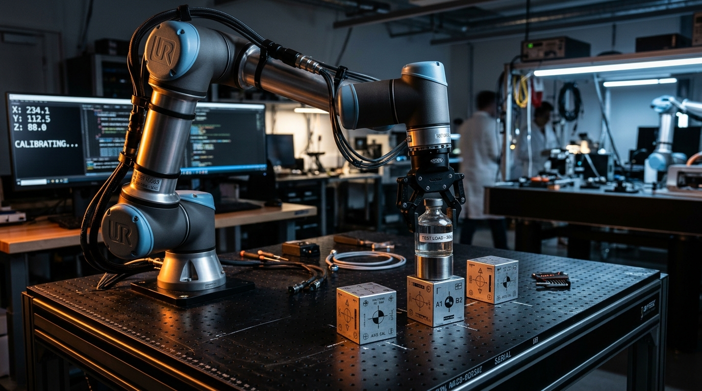
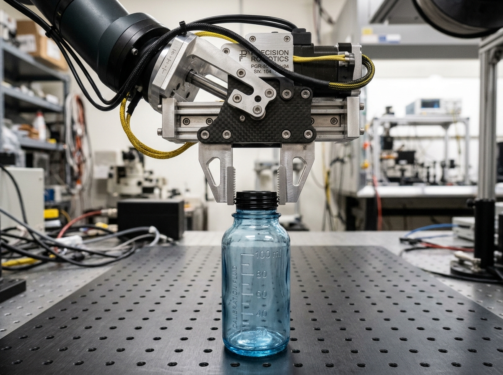

<div align="center">

# AxisLab 6

**Browser-Native 6-DOF Robotic Arm Simulation, Physics Manipulation, and Demonstration Collection Platform**

[](https://www.typescriptlang.org/)
[](https://react.dev/)
[](https://threejs.org/)
[](https://rapier.rs/)
[](https://wiki.ros.org/rosbridge_suite)
[-16A34A?style=flat-square)](#testing)
[](#51-robot-configuration-space)
[-7C3AED?style=flat-square)](#58-training-environment--augmented-random-search)
[](#15-license)

[Abstract](#1-abstract) · [Technical Architecture](#4-technical-architecture) · [Mathematical Foundations](#5-mathematical-foundations) · [Feature Matrix](#6-feature-matrix) · [Installation](#7-installation-and-quick-start) · [Dataset Schema](#9-dataset-specification) · [Benchmarking](#11-benchmarking) · [Roadmap](#13-roadmap)

<br />



<sub><em>AxisLab 6 interactive laboratory executing the Bottle Flip Challenge demonstration: articulated 6-axis manipulator, Rapier3D parallel-jaw grasp state, keyframe timeline, and 48 V electromechanical telemetry oscilloscope.</em></sub>

</div>

---

> [!NOTE]
> **Documentation Scope**: Module names, kinematic parameters, physics rules, schema fields, UI controls, and capability statuses below were checked against the source code (`src/robotics/`, `src/physics/`, `src/sim/`, `src/scene/`, `src/components/`, `src/data/`) as of November 2026, and benchmark numbers come from a reproducible run (see [§11](#11-benchmarking)). Planned or partially wired features (remote demonstration sync, closed-loop hardware feedback, neural-network policies) are labeled as such. CI badges are omitted because no `.github/workflows` pipeline exists yet.

---

## Table of Contents

- [1. Abstract](#1-abstract)
- [2. Research Motivation](#2-research-motivation)
- [3. System Overview](#3-system-overview)
- [4. Technical Architecture](#4-technical-architecture)
  - [4.1 Overall System Architecture](#41-overall-system-architecture)
  - [4.2 Robot Control Pipeline (Joint & Direct IK)](#42-robot-control-pipeline-joint--direct-ik)
  - [4.3 Physics & Grasp Interaction Loop](#43-physics--grasp-interaction-loop)
  - [4.4 Demonstration Recording & Export Pipeline](#44-demonstration-recording--export-pipeline)
  - [4.5 Repository Directory Structure](#45-repository-directory-structure)
- [5. Mathematical Foundations](#5-mathematical-foundations)
  - [5.1 Robot Configuration Space](#51-robot-configuration-space)
  - [5.2 End-Effector Pose](#52-end-effector-pose)
  - [5.3 Forward Kinematics](#53-forward-kinematics)
  - [5.4 Inverse Kinematics](#54-inverse-kinematics)
  - [5.5 Trajectory Representation & Interpolation](#55-trajectory-representation--interpolation)
  - [5.6 Demonstration Dataset Formulation](#56-demonstration-dataset-formulation)
  - [5.7 Quasi-Static Torque, Power Telemetry & Upright Criterion](#57-quasi-static-torque-power-telemetry--upright-criterion)
  - [5.8 Training Environment & Augmented Random Search](#58-training-environment--augmented-random-search)
  - [5.9 Balance Experiment Dynamics](#59-balance-experiment-dynamics)
- [6. Feature Matrix](#6-feature-matrix)
- [7. Installation and Quick Start](#7-installation-and-quick-start)
- [8. Usage & Interactive Workflows](#8-usage--interactive-workflows)
- [9. Dataset Specification](#9-dataset-specification)
  - [9.1 JSON Trajectory Schema (`axislab.demonstration.v1`)](#91-json-trajectory-schema-axislabdemonstrationv1)
  - [9.2 Tabular CSV Format](#92-tabular-csv-format)
  - [9.3 Downstream Imitation Learning Ingestion (External Python Pipeline)](#93-downstream-imitation-learning-ingestion-external-python-pipeline)
- [10. Visual Documentation](#10-visual-documentation)
- [11. Benchmarking](#11-benchmarking)
- [12. Research Applications](#12-research-applications)
- [13. Roadmap](#13-roadmap)
- [14. Contributing & Citation](#14-contributing--citation)
- [15. License](#15-license)
- [16. References](#16-references)

---

## 1. Abstract

**AxisLab 6** is an interactive, browser-native robotic manipulation playground designed for kinematic experimentation, rigid-body pick-and-place interaction, dynamic release tasks, structured human demonstration capture, and in-browser reinforcement learning. Built on React Three Fiber, Three.js, and WebAssembly-compiled Rapier3D physics, AxisLab 6 eliminates local simulator installation overhead while providing real-time numerical forward kinematics (FK), Damped Least-Squares inverse kinematics (IK) with Levenberg–Marquardt-style adaptive damping, parallel-jaw gripper and balance-plate end effectors, per-robot actuator telemetry, and structured JSON/CSV demonstration export (`axislab.demonstration.v1`).

Three robot models are selectable: the reference **Axis-6R** 6-DOF arm and two open-source hobby arms, **SO-101** (Hugging Face LeRobot) and **Koch v1.1**, with link lengths and joint ranges taken from their published URDFs. Physics advances on a **fixed 120 Hz clock**, so a replay is bit-for-bit identical at any frame rate. A **Gymnasium-style training sandbox** (`reset`/`step`/reward) runs **Augmented Random Search** in a Web Worker with live preview, domain randomization, and policy export; with it, a linear policy learns to **balance a ball on a plate** within about ten iterations on all three robots. The architecture also includes a WebSocket / ROS 2 `rosbridge_suite` adapter, a lab item inventory with mouse drag/throw, and browser-local persistence for demonstrations, scenes, and preferences.

---

## 2. Research Motivation

Dexterous and contact-rich **robotic manipulation** remains one of the central open challenges in embodied intelligence. Even seemingly elementary tabletop skills—approaching an object without toppling it, closing parallel jaws with appropriate clearance, transporting mass under gravity torque limits, or executing dynamic non-prehensile releases such as an inverted-pendulum or bottle-flip launch—require tight coordination between spatial geometry, contact physics, and continuous trajectory generation.

Modern robot learning increasingly relies on **Learning from Demonstration (LfD)** and **imitation learning** (e.g., Behavioral Cloning, Action Chunking Transformers, Diffusion Policies, and Vision–Language–Action models) to bypass brittle hand-engineered state machines. However, scaling **human-to-robot motion transfer** introduces major systems bottlenecks:

1. **Accessibility and Teleoperation Friction**: Native robotics simulators (Isaac Lab, MuJoCo, Gazebo, PyBullet) require GPU drivers, OS-specific toolchains, or Python/C++ environments that hinder rapid crowd-sourced demonstration collection and educational prototyping.
2. **Bridging Trajectory Generation and Robot Control**: Operators need immediate visual feedback coupling **Cartesian intent** (moving a tool center point in $\mathrm{SE}(3)$) with **configuration-space feasibility** (joint limits, reach boundaries, singular configurations, and wrist orientation).
3. **Simulation as a Safe Pre-Deployment Sandbox**: Interactive browser simulation provides deterministic reset (`resetObjects`), reproducible seed trajectories, configurable physical primitives (variable mass, friction, composite center-of-mass such as the two-collider ballasted bottle), and telemetry instrumentation before commanding physical actuators over middleware such as ROS 2.

AxisLab 6 addresses these needs as a lightweight, zero-install manipulation workbench focused on **kinematic transparency, interactive demonstration curation, and portable trajectory datasets**.

---

## 3. System Overview

AxisLab 6 separates its runtime into two complementary surfaces inside a single TypeScript application (`src/App.tsx`):

1. **Research Portal & Onboarding (`src/components/LandingPage.tsx`)**: A scrollable overview presenting simulator specifications, high-resolution workbench imagery, feedback collection, profile customization, and public email registration (`src/data/platformStore.ts`).
2. **Interactive 3D Robotics Laboratory (`appView === 'simulator'`, or direct launch via `?autostart=1`)**:
   - **Top Toolbar (`TopToolbar.tsx`)**: Simulation run/pause, lab reset, record toggle, demonstration playback, JSON/CSV export, real-time power & bus-current readout (per robot: `48 V` Axis-6R, `12 V` hobby arms), **robot model selector**, **experiment selector** (`Workbench` with gripper / `Balance` with plate + ball, plus **Reset ball**), **Train** (training sandbox), ROS 2 hardware bridge modal, feedback, and user profile switcher.
   - **Left Sidebar (`LeftSidebar.tsx`)**: Articulated hierarchy of the selected robot (`BASE`, `J1`–`J6`, `TCP`; the unused J4 slot of 5-DOF arms is shown as locked), workbench object list with **Add item from inventory**, object inspector with one-click IK hover alignment (`Align Gripper Above (IK)`), **Duplicate** and **Delete**, viewport overlays (joint axes triads, spherical workspace envelope, optical breadboard grid), and camera presets (`perspective`, `top`, `front`, `side`).
   - **Training Sandbox (`TrainingSandboxModal.tsx`)**: Docked side panel to train an ARS policy on `Reach Target`, `Pick & Lift Cube`, or `Balance Ball` for the selected robot, with editable hyperparameters, domain randomization, a live learning curve, a **live preview** that loops the current policy in the viewer every iteration, **Watch best in viewer**, and **Export policy**.
   - **Lab Item Inventory (`InventoryModal.tsx`)**: Catalog of 11 lab items (calibration cubes, gauge block, wooden block, aluminium peg, brass weight, glass beaker, petri dish, steel/rubber balls, water bottle) with real dimensions and materials; mass = density × volume. Items spawn at a free spot within the selected robot's reach and can be dragged, thrown, duplicated, or deleted (`Del` key).
   - **Center 3D Viewport (`RoboticsViewport.tsx`)**: ACES-filmic PBR Three.js scene featuring the selected robot (`RobotArmMesh.tsx` for Axis-6R; `ServoArmMesh.tsx` draws the hobby arms as printed brackets and serial-bus servos straight from forward kinematics), the balance plate tool, training goal markers, optical breadboard workbench (`LabEnvironment.tsx`) with mouse-draggable props, interactive `TransformControls` 3D XYZ/RPY gizmo in Direct IK mode, and software-WebGL (`SwiftShader`) adaptive pacing.
   - **Right Sidebar (`RightSidebar.tsx`)**: Dual control mode switcher (`Joint Control` vs. `Direct IK`), real-time FK vs. target pose comparison with millimeter error badge, `J1`–`J6` sliders with $\pm 1^\circ$ incremental buttons and per-joint wattage/load bars, and parallel gripper stroke (`0–80 mm`) and contact state controls.
   - **Bottom Panel (`BottomTimelinePanel.tsx` & `SimulationGraphs.tsx`)**: Demonstration library (seeded with `Bottle Flip Challenge` and `Pick & Place Red Cube`), task metadata editor, auto-sampled/manual keyframe recording, timeline scrubber with `0.5x–2.0x` variable-speed loop playback, per-step action relabeling/removal, and a `12.5 Hz` SVG oscilloscope plotting **Power (W)**, **Joints (°)**, and **Bottle Flip** height/tilt metrics.

---

## 4. Technical Architecture

### 4.1 Overall System Architecture



---

### 4.2 Robot Control Pipeline (Joint & Direct IK)

AxisLab 6 supports two mutually synchronized control paths that always resolve to clamped joint-space configurations $q \in \mathbb{R}^6$:



---

### 4.3 Physics & Grasp Interaction Loop

Rendering is driven inside `SimulationLoopDriver` (`RoboticsViewport.tsx`), adapting automatically between native GPU `requestAnimationFrame` (`frameloop="always"`) and a GPU-fence-paced timer (`frameloop="demand"`, `~85–90 ms` step) when running on software WebGL (`SwiftShader` / `llvmpipe`). **Physics is decoupled from the render rate**: `RoboticsPhysicsWorld.step(dt)` accumulates frame time and advances Rapier in exact `1/120 s` steps (remainder carried to the next frame), interpolating the kinematic gripper/plate/carried-object poses across the steps. Demo playback samples the trajectory once per physics step, so a replay is identical at 12, 60, or 144 fps:

```mermaid
sequenceDiagram
    participant R3F as SimulationLoopDriver
    participant App as App.tsx (handleStepFrame)
    participant Phys as RoboticsPhysicsWorld (Rapier3D)
    participant Mesh as InteractivePhysicsObjects
    participant Tel as telemetry.ts

    R3F->>App: onStepFrame(dt)
    alt Playback Active
        loop every fixed 1/120 s of accumulated time
            App->>App: interpolateDemoAtTime(demo, t)
            App->>Phys: evaluateGrasp(..., forcedObjectId)
            App->>Phys: updateGripperPose(tcpPos, tcpQuat, width)
            App->>Phys: step(1/120)
        end
    else Manual / IK Teleoperation
        App->>App: Servo gripper width (150 mm/s)
        App->>Phys: evaluateGrasp(tcpPos, tcpQuat, width)
        App->>Phys: updateGripperPose(tcpPos, tcpQuat, width)
        App->>Phys: step(dt)
    end
    Note over Phys: Accumulator: n = floor(acc / (1/120)) fixed steps;<br/>kinematic bodies lerp/slerp across the n steps;<br/>carried body's frame velocity = release (throw) velocity
    Mesh->>Phys: useFrame() reads body translations/rotations
    opt Every >= 80 ms (~12.5 Hz)
        App->>Tel: computeRobotTelemetry() & bottle flip state
    end
```

---

### 4.4 Demonstration Recording & Export Pipeline



---

### 4.5 Repository Directory Structure

<details>
<summary><strong>Click to expand full repository file inventory (verified against workspace)</strong></summary>

```text
.
├── .env.example                       # Optional environment template (GEMINI_API_KEY, APP_URL)
├── index.html                         # Root SPA HTML (Plus Jakarta Sans & IBM Plex Mono fonts, metadata)
├── metadata.json                      # Application manifest ("AxisLab 6-DOF Robotics Simulator")
├── package.json                       # Vite + React 19 + Three.js + Rapier3D dependencies
├── tsconfig.json                      # TypeScript compiler configuration (ES2022, bundler resolution)
├── vite.config.ts                     # Vite build config + src/assets copy plugin
├── public/
│   └── media/
│       └── axislab-simulator-preview.png  # 1600x900 live workbench screenshot
└── src/
    ├── App.tsx                        # Top-level router (landing vs simulator), physics lifecycle, recording/playback loop
    ├── main.tsx                       # React DOM entry point
    ├── index.css                      # Tailwind CSS v4 import, scrollbar & slider styles
    ├── assets/images/
    │   ├── axislab_hero_arm_1794994281866.jpg         # 1376x768 hero studio image
    │   └── axislab_gripper_closeup_1794994281412.jpg  # 1200x896 parallel-jaw grasp close-up
    ├── robotics/
    │   ├── types.ts                   # Core kinematic, object, demonstration, actuator, and bridge TypeScript interfaces
    │   ├── robotModel.ts              # Axis-6R, SO-101, Koch v1.1 configs (joints, limits, actuators) & DEFAULT_SCENE_OBJECTS
    │   ├── robotModel.test.ts         # Unit tests: home poses, IK reachability, per-robot telemetry
    │   ├── labInventory.ts            # Lab item catalog, density x volume mass, reach-aware free-spot placement, scene persistence
    │   ├── labInventory.test.ts       # Unit tests: mass, placement, duplication
    │   ├── kinematics.ts              # Forward kinematics, 6-DOF DLS Inverse Kinematics, Euler/Quaternion helpers
    │   ├── kinematics.test.ts         # Unit tests for FK stack height, IK round-trips, out-of-reach stability, clamping
    │   ├── dataset.ts                 # Recording frame builder, lerp interpolator, JSON/CSV serializers, seeded demos
    │   ├── dataset.test.ts            # Unit tests for seeded demos, interpolation, CSV/JSON serialization
    │   ├── telemetry.ts               # Quasi-static gravity/dynamic torque, 48V bus power, bottle tilt & flip detection
    │   ├── telemetry.test.ts          # Unit tests for payload/velocity torque scaling and upright classification
    │   └── bridge.ts                  # WebSocketRobotBridge (ROS 2 rosbridge_suite & generic JSON)
    ├── physics/
    │   ├── rapierWorld.ts             # Rapier3D world: fixed 120 Hz stepping, bench/tray/robot base, two-collider bottle,
    │   │                              #   kinematic jaws & grasp logic, balance plate tool, mouse drag, runtime add/remove
    │   └── rapierWorld.test.ts        # Unit tests: resting contact, frame-rate-independent throws, drag, grasp, seeded bottle flip
    ├── sim/
    │   ├── env.ts                     # Gymnasium-style RobotArmEnv (reset/step), tasks, domain randomization
    │   ├── ars.ts                     # Augmented Random Search (V2-t), linear policy, rollout -> Demonstration export
    │   ├── balance.ts                 # Balance experiment setup shared by env and viewer (plate size, home pose, ball)
    │   ├── trainer.worker.ts          # Web Worker: runs training, streams progress + live preview rollouts
    │   └── env.test.ts                # Unit tests: determinism, solvability, ARS learning (reach, balance)
    ├── scene/
    │   ├── RoboticsViewport.tsx       # R3F Canvas, OrbitControls, TransformControls gizmo, plate & goal markers, SwiftShader loop
    │   ├── RobotArmMesh.tsx           # Procedural PBR Axis-6R geometry, workspace sphere, RGB XYZ axis triads
    │   ├── ServoArmMesh.tsx           # Procedural SO-101 / Koch model (printed brackets + servos) drawn from FK
    │   ├── LabEnvironment.tsx         # PMREM StudioEnvironmentRig, optical breadboard texture, contact shadows, prop meshes
    │   └── materials.ts               # Software WebGL detector, procedural breadboard canvas textures, PBR material presets
    ├── data/
    │   ├── platformStore.ts           # Public email registration, profile preferences & feedback persistence
    │   └── platformStore.test.ts      # Unit tests for email/display-name validation, profiles, feedback, deduplication
    └── components/
        ├── LandingPage.tsx            # Scrollable landing showcase, metrics, preview, capabilities, registration
        ├── TopToolbar.tsx             # Simulator header bar (sim state, reset, record, play, export, power, bridge, profile)
        ├── LeftSidebar.tsx            # Scene hierarchy, object pose inspector, overlays, camera presets
        ├── RightSidebar.tsx           # Joint Control vs Direct IK panel, J1-J6 sliders, gripper stroke & contact indicator
        ├── BottomTimelinePanel.tsx    # Saved demonstration list, recorder controls, scrubber, keyframe editor
        ├── SimulationGraphs.tsx       # Multi-channel SVG oscilloscope (Power W, Joints deg, Bottle Flip height/tilt)
        ├── HardwareBridgeModal.tsx    # ROS 2 rosbridge / WebSocket connection modal
        ├── TrainingSandboxModal.tsx   # Training side panel: task/robot/hyperparameters, learning curve, live preview, export
        ├── InventoryModal.tsx         # Lab item inventory (add items, restore default lab set)
        ├── AuthModal.tsx              # Public email + display name registration/sign-in modal
        ├── ProfileModal.tsx           # User avatar color, display name, notes, default control mode & axes preferences
        └── FeedbackModal.tsx          # Categorized 1-5 star feedback modal
```

</details>

---

## 5. Mathematical Foundations

> [!IMPORTANT]
> **Theory vs. Implementation Note**: The equations below present the standard $\mathrm{SE}(3)$ formulation alongside the **exact discrete algorithms** implemented in `src/robotics/kinematics.ts`, `src/robotics/robotModel.ts`, `src/robotics/dataset.ts`, and `src/robotics/telemetry.ts`.

### 5.1 Robot Configuration Space

The **Axis-6R Articulated Manipulator** (`AXIS6_ROBOT_CONFIG` in `src/robotics/robotModel.ts`) operates in a 6-dimensional revolute configuration space $\mathcal{Q} \subset \mathbb{R}^6$:

$$q = [q_1, q_2, q_3, q_4, q_5, q_6]^\top$$

where each joint angle $q_i$ (stored in degrees in UI/dataset state and converted via $\theta_i = \frac{\pi}{180} q_i$ during kinematic evaluation) is bounded by box constraints $q_i \in [q_{i,\min}, q_{i,\max}]$:

| Joint | Name | Role | Local Rotation Axis $\hat{\omega}_i$ | Parent Offset $\mathbf{d}_i$ (m) | Limits $[q_{\min}, q_{\max}]$ | Home Pose $q_{\text{home}}$ | Max Speed ($^\circ$/s) |
| :--- | :--- | :--- | :---: | :---: | :---: | :---: | :---: |
| `J1` | Base Waist | Yaw | $(0, 1, 0)$ | $(0, 0.140, 0)$ | $[-175^\circ, +175^\circ]$ | $0^\circ$ | $180^\circ/\text{s}$ |
| `J2` | Shoulder | Pitch | $(0, 0, -1)$ | $(0, 0.160, 0)$ | $[-105^\circ, +115^\circ]$ | $26^\circ$ | $160^\circ/\text{s}$ |
| `J3` | Elbow | Pitch | $(0, 0, -1)$ | $(0, 0.360, 0)$ | $[-135^\circ, +145^\circ]$ | $72^\circ$ | $180^\circ/\text{s}$ |
| `J4` | Forearm | Roll | $(0, 1, 0)$ | $(0, 0.220, 0)$ | $[-180^\circ, +180^\circ]$ | $0^\circ$ | $240^\circ/\text{s}$ |
| `J5` | Wrist | Pitch | $(0, 0, -1)$ | $(0, 0.100, 0)$ | $[-125^\circ, +125^\circ]$ | $82^\circ$ | $220^\circ/\text{s}$ |
| `J6` | Tool Flange | Roll | $(0, 1, 0)$ | $(0, 0.090, 0)$ | $[-180^\circ, +180^\circ]$ | $0^\circ$ | $300^\circ/\text{s}$ |
| `TCP` | Tool Center Point | Fixed Flange Offset | — | $(0, 0.115, 0)$ | Spherical reach: $[0.16\,\text{m}, 0.92\,\text{m}]$ | — | — |

At $q_{\text{zero}} = [0, 0, 0, 0, 0, 0]^\top$, the total vertical stack height from the base origin (`[0, 0, 0]`) to the TCP is:

$$y_{\text{TCP}}(q_{\text{zero}}) = 0.14 + 0.16 + 0.36 + 0.22 + 0.10 + 0.09 + 0.115 = 1.185\,\text{m}$$

#### Open-Source Hobby Arms (SO-101, Koch v1.1)

Both are 5-DOF arms (pan, shoulder, elbow, wrist flex, wrist roll + gripper). They are mapped onto the same 6-slot chain with **J4 (forearm roll) locked at 0°**, because they have no such joint; zero pose is the arm pointing straight up, as for Axis-6R. Link lengths follow the published URDFs ([SO-ARM100 `so101_new_calib.urdf`](https://github.com/TheRobotStudio/SO-ARM100), [ManiSkill `follower_arm_v1.1.urdf`](https://github.com/mani-skill/ManiSkill) for [Koch v1.1](https://github.com/jess-moss/koch-v1-1)); joint ranges keep each joint's real span, re-centered on this zero pose.

| Joint | SO-101 offset (m) | SO-101 limits | Koch v1.1 offset (m) | Koch v1.1 limits |
| :--- | :---: | :---: | :---: | :---: |
| `J1` Pan (yaw) | $(0, 0.0624, 0)$ | $\pm 110^\circ$ | $(0, 0.041, 0)$ | $\pm 180^\circ$ |
| `J2` Shoulder (pitch) | $(0, 0.0542, 0)$ | $\pm 100^\circ$ | $(0, 0.0154, 0)$ | $[-30^\circ, +96^\circ]$ |
| `J3` Elbow (pitch) | $(0, 0.1126, 0)$ | $\pm 97^\circ$ | $(0, 0.1084, 0)$ | $[-30^\circ, +145^\circ]$ |
| `J4` (locked) | $(0, 0.1349, 0)$ | $0^\circ$ | $(0, 0.1005, 0)$ | $0^\circ$ |
| `J5` Wrist flex (pitch) | $(0, 0, 0)$ | $\pm 95^\circ$ | $(0, 0, 0)$ | $[-86^\circ, +123^\circ]$ |
| `J6` Wrist roll | $(0, 0.0611, 0)$ | $[-157^\circ, +163^\circ]$ | $(0, 0.0448, 0)$ | $\pm 180^\circ$ |
| `TCP` | $(0, 0.0981, 0)$ | reach $\approx 0.40\,\text{m}$ | $(0, 0.065, 0)$ | reach $\approx 0.30\,\text{m}$ |
| Actuators | 12 V Feetech STS3215, $225^\circ/\text{s}$ | | 12 V Dynamixel XL430/XL330, $240^\circ/\text{s}$ | |

> [!NOTE]
> Joint speeds are typical loaded servo speeds (the URDFs do not specify them). The SO-101 cannot keep its tool vertical beyond about 40% of its reach, because its wrist runs out of range (±95°), the same as the real arm.

---

### 5.2 End-Effector Pose

In Three.js right-handed Y-up world coordinates (workbench top surface flush at $y = 0$), the end-effector Tool Center Point (TCP) pose is parameterized by its 3D Cartesian position and intrinsic `'XYZ'` Euler angles $(\phi, \theta, \psi)$ converted from the unit quaternion $Q_{\text{TCP}} = (q_x, q_y, q_z, q_w) \in \mathbb{S}^3$:

$$x = [p_x, p_y, p_z, \phi, \theta, \psi]^\top \in \mathbb{R}^3 \times \mathrm{SO}(3)$$

Internally, both kinematics and dataset frames preserve the singularity-free unit quaternion `tcpQuaternion` alongside `tcpEulerDeg` to avoid gimbal lock during orientation error computation.

---

### 5.3 Forward Kinematics

The general rigid-body forward kinematics map along a serial kinematic chain of $n=6$ joints is expressed as a product of homogeneous transformation matrices $T_{i-1}^i \in \mathrm{SE}(3)$:

$$T_0^n(q) = \left( \prod_{i=1}^{n} T_{i-1}^{i}(q_i) \right) T_n^{\text{TCP}}, \qquad T_{i-1}^{i}(q_i) = \begin{bmatrix} R_i(\hat{\omega}_i, \theta_i) & \mathbf{d}_i \\ \mathbf{0}^\top & 1 \end{bmatrix}$$

**Verified Implementation (`computeForwardKinematics` in `src/robotics/kinematics.ts`)**: Rather than classical 4-parameter Denavit–Hartenberg tables, AxisLab 6 evaluates the isomorphic URDF-style parent-relative offset and axis-angle quaternion chain cleanly in $O(n)$ operations:

$$\mathbf{p}_i = \mathbf{p}_{i-1} + Q_{i-1} \mathbf{d}_i Q_{i-1}^{-1}, \qquad Q_i = \mathrm{normalize}\!\left(Q_{i-1} \otimes \exp\!\left(\frac{\theta_i}{2}\hat{\omega}_i\right)\right)$$

ending with $\mathbf{p}_{\text{TCP}} = \mathbf{p}_6 + Q_6 \mathbf{d}_{\text{TCP}} Q_6^{-1}$ and $Q_{\text{TCP}} = Q_6$. All intermediate transforms `[BASE, J1, J2, J3, J4, J5, J6, TCP]` are returned for visualization and torque moment-arm calculation.

---

### 5.4 Inverse Kinematics

Given a desired TCP pose $(\mathbf{p}^*, Q^*)$, differential inverse kinematics relates Cartesian task-space error $\Delta x \in \mathbb{R}^6$ to joint-space increments $\Delta q \in \mathbb{R}^6$ via the manipulator geometric Jacobian $J(q) \in \mathbb{R}^{6 \times 6}$:

$$\Delta x \approx J(q)\,\Delta q \quad \Longrightarrow \quad \Delta q = J(q)^+\,\Delta x$$

where $J(q)^+$ is the Moore–Penrose pseudoinverse. Because $J(q)^+$ becomes ill-conditioned near kinematic singularities (such as full vertical extension or wrist alignment $q_5 \approx 0^\circ$), AxisLab 6 implements **Damped Least-Squares** inverse kinematics with a Levenberg–Marquardt-style, error-scheduled damping term (strictly, not the full LM trust-region update) (`solveInverseKinematics` in `src/robotics/kinematics.ts`), minimizing $\|J(q)\Delta q - e\|^2 + \lambda^2\|\Delta q\|^2$:

$$\left(J(q)^\top J(q) + \lambda^2 I_6\right)\Delta q = J(q)^\top e$$

**Verified Algorithmic Details**:
1. **Task Error Vector $e \in \mathbb{R}^6$**: Combines positional residual $\mathbf{e}_p = \mathbf{p}^*_{\text{clamped}} - \mathbf{p}_{\text{TCP}}(q)$ and weighted axis-angle orientation residual on $\mathrm{SO}(3)$ derived from the quaternion difference $Q_{\text{err}} = Q^* \otimes Q_{\text{TCP}}^{-1}$ (with shortest-arc sign normalization $w \ge 0$):
   $$e = \begin{bmatrix} \mathbf{e}_p \\ w_{\text{rot}} \cdot \mathrm{Log}(Q_{\text{err}}) \end{bmatrix}, \qquad w_{\text{rot}} = 0.42$$
2. **Workspace & Floor Guards**: Prior to iteration, the target height is clamped to $p_y^* \ge 0.012\,\text{m}$, and radial distance from the shoulder pivot ($y_s = 0.30\,\text{m}$) is radially projected onto the sphere $r_{\max} = 0.92\,\text{m}$.
3. **Numerical Jacobian**: Each column $j \in \{1,\dots,6\}$ is evaluated by central-free forward finite differences of `computeForwardKinematics` with perturbation $\epsilon = 0.05^\circ$ ($\epsilon_{\text{rad}} = 8.727 \times 10^{-4}\,\text{rad}$).
4. **Adaptive Damping & Solver**: Uses error-adaptive damping $\lambda = \lambda_0 + \min(0.12,\, 0.15 \|\mathbf{e}_p\|_2)$ with $\lambda_0 = 0.06$, solves the $6 \times 6$ symmetric positive-definite linear system via **Gaussian elimination with partial pivoting** (`solveLinear6x6`), clamps per-iteration step size to $|\Delta q_j| \le 18^\circ$, and projects onto joint box limits.
5. **Stopping Criteria**: Terminates when $\|\mathbf{e}_p\|_2 \le 1.2\,\text{mm}$ and $\|\mathbf{e}_r\|_2 \le 0.015\,\text{rad}$, or at `maxIterations = 48` (convergence flag reported within $2.5\times$ tolerance).

---

### 5.5 Trajectory Representation & Interpolation

Time-indexed robot trajectories are represented as ordered sequences of discrete keyframes $\{t_k, q_k, g_k, a_k\}_{k=0}^{M-1}$. During playback and timeline scrubbing, `interpolateDemoAtTime` (`src/robotics/dataset.ts`) evaluates **piecewise linear joint-space interpolation** between surrounding timestamps $t_k \le t \le t_{k+1}$:

$$\alpha = \mathrm{clamp}\!\left(\frac{t - t_k}{\max(1,\, t_{k+1} - t_k)},\, 0,\, 1\right), \qquad q(t) = (1 - \alpha)q_k + \alpha q_{k+1}, \qquad w_g(t) = (1 - \alpha)w_{g,k} + \alpha w_{g,k+1}$$

Discrete symbolic variables (`action`, `graspedObjectId`) switch at the midpoint ($\alpha < 0.5$), while `isGrasping` remains `true` across intervals where both bounding frames maintain grasp state.

---

### 5.6 Demonstration Dataset Formulation

In standard imitation learning notation, an episodic demonstration trajectory of length $T$ is formalized as:

$$D = \{(s_t, a_t, o_t)\}_{t=0}^{T}$$

Mapping directly onto AxisLab 6's `DemoFrame` (`src/robotics/types.ts`):
- **State / Proprioception ($s_t$)**: Timestamp `timestampMs`, joint configuration `jointAnglesDeg` ($q_t \in \mathbb{R}^6$), forward-kinematic pose (`tcpPosition`, `tcpEulerDeg`, `tcpQuaternion`), and gripper telemetry (`gripperWidthMm`, `isGrasping`, `graspedObjectId`).
- **Action ($a_t$)**: Semantic skill label `action` (`Home`, `Move Joint`, `Move Linear`, `Pick Object`, `Close Gripper`, `Move Object`, `Bottle Flip`, `Place Object`, `Open Gripper`, `Idle`) alongside commanded joint/gripper targets implied by successive frames $\Delta q_t = q_{t+1} - q_t$.
- **Environment Observation ($o_t$)**: Ground-truth world poses `[id, position, quaternion]` for all scene objects (`objects: DemoObjectSnapshot[]`), enabling supervised state-based behavioral cloning without requiring visual rendering at training time.

---

### 5.7 Quasi-Static Torque, Power Telemetry & Upright Criterion

To provide real-time actuator load feedback (`src/robotics/telemetry.ts`), AxisLab 6 evaluates an analytical **quasi-static gravity + velocity torque estimator** at $\sim 12.5\,\text{Hz}$ (not full inverse dynamics / RNEA):

$$\tau_i = \tau_{g,i} + \tau_{\text{dyn},i}, \qquad \tau_{g,i} = \begin{cases} 0.65\, (m_{\text{down},i} + m_{\text{payload}})\, g \, r_{\perp,i} & \text{if pitch joint } (|\hat{\omega}_{i,z}| > 0.5) \\ 0.04\, (m_{\text{down},i} + m_{\text{payload}})\, g & \text{if yaw/roll joint} \end{cases}$$

where $r_{\perp,i} = \sqrt{(p_{\text{TCP},x} - p_{i,x})^2 + (p_{\text{TCP},z} - p_{i,z})^2}$ is the horizontal moment arm from joint $i$ to the TCP and $\tau_{\text{dyn},i} = |\dot{\theta}_i|(1.2 + 0.35\, m_{\text{eff},i})$. Per-joint electrical power models copper $I^2R$ holding losses ($k_{Cu}\tau^2$), shaft mechanical power ($\eta = 0.82$), and servo standby, summed with controller overhead onto the robot's bus. Rated torques, downstream masses, $k_{Cu}$, standby/idle power, and bus voltage come from each robot's `actuators` model (`robotModel.ts`):

| Robot | Bus | Rated torque J1–J6 (N·m) | $k_{Cu}$ (W/N²m²) | Standby / controller idle |
| :--- | :---: | :---: | :---: | :---: |
| Axis-6R | 48 V | 48, 56, 36, 16, 14, 8 | 0.045 | 2.4 W / 18.5 W |
| SO-101 | 12 V | 1.5, 1.5, 1.5, –, 1.5, 1.5 | 3.8 | 0.12 W / 0.6 W |
| Koch v1.1 | 12 V | 1.4, 1.4, 1.4, –, 0.6, 0.6 | 4.5 | 0.10 W / 0.5 W |

The bus sags under load, $V_{\text{bus}} = \max\big(0.9625\,V_{\text{nom}},\; V_{\text{nom}} - 0.0032\,P_{\text{total}}\,V_{\text{nom}}/48\big)$, which reduces to the original $\max(46.2,\, 48 - 0.0032\,P)$ for the 48 V arm. The locked J4 slot of 5-DOF arms draws no power.

For the **Bottle Flip Challenge**, `isBottleUprightOnBench` measures tilt relative to world $+Y$ via $\theta_{\text{tilt}} = \arccos(\hat{y}_{\text{bottle}} \cdot \hat{y}_{\text{world}})$ and increments the flip counter when a **released, airborne** bottle (not grasped, and $y > 0.115\,\text{m}$, or $\|\omega\| > 2.2\,\text{rad/s}$ while $y > 0.075\,\text{m}$) settles upright ($\theta_{\text{tilt}} \le 14^\circ$, $0.045 \le y \le 0.095\,\text{m}$, $\|\mathbf{v}\| < 0.06\,\text{m/s}$). Earlier versions also counted a wobble on the bench as a flip.

The seeded **Bottle Flip Challenge** throw keeps every joint within its rated speed (segment times are derived from the joint limits by `segmentMsWithinSpeedLimits`). It releases the bottle at $\approx 0.55\,\text{m}$ moving up at $\approx 2.6\,\text{m/s}$ with $\approx 8.4\,\text{rad/s}$ of spin, the bottle turns $\approx 330^\circ$ in the air without touching the gripper, and it lands upright. The trajectory was found by a headless Rapier search and is robust to $\pm 0.3^\circ$ joint perturbations (8/8); at $\pm 1^\circ$ it succeeds in 27 of 40 cases, still far more reliable than a human bottle flip.

---

### 5.8 Training Environment & Augmented Random Search

`RobotArmEnv` (`src/sim/env.ts`) follows the Gymnasium API: `reset(seed) → obs` and `step(a) → (obs, reward, terminated, truncated, info)`, controlled at $20\,\text{Hz}$ ($\Delta t_c = 0.05\,\text{s}$, six fixed $1/120\,\text{s}$ physics steps per control step). It is deterministic for a given seed, with and without domain randomization (unit-tested).

| Task | Action $a \in [-1,1]^m$ | Observation | Reward / termination |
| :--- | :--- | :--- | :--- |
| Reach Target | `ee_delta` ($m{=}4$): TCP $\Delta xyz \cdot 0.5\,\text{m/s}$ (scaled to reach) solved by DLS IK + gripper; or `joint_velocity` ($m{=}7$) | 20: $q/180$, $\dot q/\dot q_{\max}$, TCP, goal−TCP, grip, grasp flag | $-\lVert p_{\text{TCP}} - g\rVert$, +0.5 inside 5 cm (Gymnasium-Robotics Fetch threshold) |
| Pick & Lift Cube | as above | 20 (goal tracks the cube) | approach + 0.3 grasp + $4\,\Delta h$; success = lifted 8 cm; knocked off bench → −10, end |
| Balance Ball | $m{=}2$: J5 / J6 tilt rate $\cdot 60^\circ/\text{s}$ | 10: ball−plate (×10), ball velocity, J5/J6 tilt, tilt rates | $1 - 2(d/R)^2$ per step; ball off plate → −5, end; success = still on after 10 s |

Joint motion is always capped at each joint's rated speed and position limits. Domain randomization covers object position ($\pm 3$ cm), mass and friction ($\pm 20\%$), initial joint offsets ($\pm 3^\circ$), and Gaussian action/observation noise.

The trainer (`src/sim/ars.ts`) is **ARS V2-t** (Mania, Guy & Recht, 2018) with a linear policy $a = \mathrm{clip}\big(W (o - \mu)/\sigma\big)$ and running observation statistics. Each iteration samples $N$ directions $\delta_k \sim \mathcal{N}(0, I)$, evaluates $W \pm \nu\delta_k$ on the same seed, keeps the top $b$ by $\max(r_k^+, r_k^-)$, and updates

$$W \leftarrow W + \frac{\alpha}{b\,\sigma_R} \sum_{k \in \text{top-}b} \left(r_k^+ - r_k^-\right)\delta_k$$

with $\sigma_R$ the standard deviation of the $2b$ selected returns. Defaults: $N{=}32$, $b{=}16$, $\alpha{=}0.3$, $\nu{=}0.2$, 8 evaluation episodes on fixed seeds; the best checkpoint is kept. $\sigma$ is floored at $0.01$, otherwise near-constant inputs (e.g. J4/J6 held still by IK) would amplify numerical noise ~$10^4\times$. Policies export as `axislab.linear-policy.v1`; rollouts export as regular `axislab.demonstration.v1` episodes.

---

### 5.9 Balance Experiment Dynamics

In the Balance experiment the gripper is replaced by a round plate (radius $R = \max(0.08,\, 0.12\,r_{\text{reach}})$: 16 cm across on the hobby arms, 22 cm on Axis-6R) whose normal is the TCP's local $-X$ axis. The arm holds it level in front of the robot (pose solved by IK per robot), so wrist flex (J5) tilts it fore/aft and wrist roll (J6) side to side. These are decoupled, and measured identical on all three robots. A rolling ball (Ø30 mm, 15 g) then obeys, per axis, approximately

$$\ddot x = \tfrac{5}{7}\, g\, \theta, \qquad \dot\theta = \omega_{\max}\, a,\quad \omega_{\max} = 60^\circ/\text{s} \approx 1.05\,\text{rad/s}$$

a third-order chain from action to ball position, so a stabilizing controller must feed back plate tilt as well as ball position and velocity. Placing all three closed-loop poles at $-3\,\text{rad/s}$ gives the linear law $a = -(4.5\,\tilde\theta + 3.67\,\dot x + 0.367\,\tilde x)$ (in observation units). It keeps the ball within about 3 cm of center on 10/10 seeds for every robot, while a passive plate drops the ball in about one second. Because the optimal controller is linear in the observation, ARS learns it from scratch in about ten iterations (see §11). Policy previews replay the recorded ball poses rather than re-simulating them, since balancing is chaotic and an open-loop replay would drift from what happened in training.

---

## 6. Feature Matrix

| Feature | Status | Verified Implementation Details |
| :--- | :---: | :--- |
| **3D robot visualization** | Implemented | Procedural PBR `Axis-6R` geometry (`RobotArmMesh.tsx`) and FK-driven SO-101 / Koch models (`ServoArmMesh.tsx`), optical breadboard workbench, composite props (`LabEnvironment.tsx`), optional joint XYZ triads, per-robot workspace sphere, 4 camera presets, SwiftShader software-WebGL fallback. |
| **Robot models** | Implemented | Axis-6R (6-DOF, 48 V), **SO-101** and **Koch v1.1** (5-DOF, 12 V servos) selectable at runtime; kinematics, IK, telemetry, inventory reach, and training follow the selection (`robotModel.ts`). |
| **Joint-space control** | Implemented | Individual sliders & $\pm 1^\circ$ step buttons for `J1`–`J6` (`RightSidebar.tsx`), limit clamping (`clampJointAnglesDeg`), Home & Zero presets, real-time FK pose and per-joint wattage/load bars. |
| **Cartesian control** | Implemented | `Direct IK` mode (`RightSidebar.tsx` + `IkGizmoController`) with interactive 3D `TransformControls` gizmo (`G` translate, `R` rotate), numerical XYZ + RPY target inputs, millimeter position error readout, and object hover alignment (`Align Gripper Above (IK)`). |
| **Forward kinematics** | Implemented | Exact parent-offset + axis-angle quaternion chaining (`computeForwardKinematics`) producing `[BASE, J1..J6, TCP]` transforms and XYZ Euler / quaternion TCP pose; unit-tested in `kinematics.test.ts`. |
| **Inverse kinematics** | Implemented | Damped Least-Squares solver (LM-style adaptive damping) (`solveInverseKinematics`) optimizing TCP position + $\mathrm{SO}(3)$ orientation with numerical Jacobian and partial-pivot $6\times 6$ Gaussian elimination; unit-tested in `kinematics.test.ts`. |
| **Gripper interaction** | Implemented | Smooth `0–80 mm` servoed parallel jaw (`targetWidthMm`), Open/Close buttons, kinematic Rapier colliders (`palmBody`, `leftFingerBody`, `rightFingerBody`), and grasping only when the object actually sits between the jaws (opening within −4/+14 mm of the object width, centered within the gap) (`evaluateGrasp`). |
| **Object manipulation** | Implemented | Rigid-body physics (`rapierWorld.ts`) for 5 default graspable props (Red Cube, Cobalt Block, Brass Cylinder, Polymer Sphere, two-collider weighted Bottle) + static 5-wall Receiving Tray + static robot pedestal collider; CCD on all props; grasps carry objects and hand over the measured frame velocity on release for throwing/flipping. |
| **Deterministic physics** | Implemented | Fixed `1/120 s` accumulator stepping with kinematic interpolation; replays and throws are identical at any frame rate (unit-tested). Contact tolerances tuned for 5 cm props (`lengthUnit = 0.1`), low realistic air damping. |
| **Lab item inventory & editing** | Implemented | 11 real lab items with density-derived masses (`labInventory.ts`), reach-aware free-spot placement, mouse drag (kinematic, pushes neighbours) with throw-on-release, Duplicate, Delete / `Del` key, persisted scene, Restore defaults. |
| **Balance experiment** | Implemented | Plate end effector + Ø30 mm ball (`balance.ts`); manual tilting via J5/J6, Reset ball, trainable `Balance Ball` task. |
| **Demonstration recording** | Implemented | Stateful auto-sampling (`>= 140 ms` and motion/grasp change thresholds) + manual `+ Keyframe` capture (`App.tsx`), task presets, custom naming, and editable keyframe action labels (`BottomTimelinePanel.tsx`); demos record their robot and experiment. *(Note: arm links J1–J6 have no colliders; only the pedestal and the end effector collide with props.)* |
| **Trajectory playback** | Implemented | Piecewise linear joint & gripper interpolation (`interpolateDemoAtTime`) at `0.5x`, `1.0x`, `1.5x`, `2.0x` speeds, Play/Pause/Stop/Repeat controls, timeline scrubbing, and 2 deterministic IK-solved demo episodes pre-seeded on boot. |
| **Dataset export** | Implemented | Browser file download of complete trajectories as structured JSON (`axislab.demonstration.v1` via `serializeDemoToJSON`) and flat 18-column CSV (`serializeDemoToCSV`); verified in `dataset.test.ts`. |
| **Reinforcement learning** | Implemented (linear policies) | Gymnasium-style `RobotArmEnv` (Reach, Pick & Lift, Balance), domain randomization, ARS V2-t trainer in a Web Worker, live learning curve, live in-viewer preview, best-checkpoint export (`axislab.linear-policy.v1`), rollouts saved as demonstrations. Balance and Reach learn reliably; Pick & Lift does not yet learn with a linear policy. |
| **Imitation learning** | Partial | Supports structured **data collection, curation, and dataset export** formatted for behavioral cloning / LfD. **No behavioral-cloning trainer or neural-network controller is implemented yet.** |
| **Hardware integration** | Partial | `WebSocketRobotBridge` (`src/robotics/bridge.ts`) and `HardwareBridgeModal.tsx` implement outbound `ros2-rosbridge` (`/joint_group_position_controller/commands`, `/gripper_controller/command`) and generic JSON WebSocket publishing plus a `/joint_states` subscription listener. Closed-loop incoming telemetry feedback into React state and real hardware validation are not yet wired. |

---

## 7. Installation and Quick Start

### Prerequisites

- **Node.js** `>= 20.x` (developed with `@types/node: ^22.14.0` and `tsx: ^4.21.0`)
- **npm** (or `bun` — a `bun.lock` is present alongside `package.json`)
- Modern WebGL2-capable browser with WebAssembly enabled (Chrome, Firefox, Edge, Safari)

### Installation

```bash
git clone <your-repository-url>
cd <repository-directory>
npm install
```

### Environment & Local Persistence

The simulator runs **100% client-side in the browser with zero required environment variables**. Recorded demonstrations, operator profiles, registrations, and feedback are persisted automatically in browser `localStorage` across sessions.

### Running & Building

| Command | Purpose | Verified Behavior |
| :--- | :--- | :--- |
| `npm run dev` | Start Vite dev server | Serves SPA on `http://localhost:3000` (`--port=3000 --host=0.0.0.0`). Append `?autostart=1` to bypass the landing page and boot straight into the 3D simulator. |
| `npm run build` | Production bundle | Runs `vite build` into `dist/` and copies `src/assets/` via the Vite bundle plugin. |
| `npm run preview` | Preview production bundle | Runs `vite preview` against `dist/`. |
| `npm run lint` | Static type checking | Runs `tsc --noEmit` across the entire TypeScript codebase. |
| `npm run clean` | Clean build artifacts | Removes `dist` and `server.js`. |

### Testing

All unit tests use Node's built-in `node:test` runner and are executed with `tsx` (Rapier's WASM build runs headless in Node, so physics and training are tested too):

```bash
npx --yes tsx --test src/robotics/kinematics.test.ts src/robotics/dataset.test.ts src/robotics/telemetry.test.ts src/robotics/labInventory.test.ts src/robotics/robotModel.test.ts src/data/platformStore.test.ts src/physics/rapierWorld.test.ts src/sim/env.test.ts
```

> Verified output: **38/38 tests passing** (~30 s, most of it two short ARS training runs):

| Suite | Tests | Covers |
| :--- | :---: | :--- |
| `platformStore.test.ts` | 6 | Registration validation, profiles, feedback persistence |
| `dataset.test.ts` | 7 | Seeded demos (incl. rated-joint-speed check), interpolation, CSV/JSON |
| `kinematics.test.ts` | 6 | FK stack height, IK round-trips, out-of-reach stability, clamping |
| `telemetry.test.ts` | 3 | Payload/velocity torque scaling, bottle upright classification |
| `labInventory.test.ts` | 3 | Density × volume mass, placement, duplication |
| `robotModel.test.ts` | 2 | Per-robot home pose, IK reachability, actuator telemetry |
| `rapierWorld.test.ts` | 6 | No sinking at rest, frame-rate-independent throws, runtime add/remove, mouse drag/throw, no closed-jaw grasps, seeded bottle flip lands upright |
| `env.test.ts` | 5 | Determinism (± DR), reach & balance solvable, ARS learns balance and reach |

> [!NOTE]
> `npm install` currently fails on an optional peer-dependency conflict (Vite 8 vs. the pinned `esbuild ^0.25`); use `npm install --legacy-peer-deps` or `bun install` until `package.json` is updated.

---

## 8. Usage & Interactive Workflows

1. **Entering the Workbench**: Click **Open Live Simulator** from the landing page (or open `http://localhost:3000/?autostart=1`). Rapier3D initializes asynchronously and exposes `data-sim-ready="true"` on the root container once active.
2. **Joint vs. Cartesian Control**:
   - Use **Joint Control** sliders (`J1`–`J6`) or $\pm 1^\circ$ buttons for direct configuration-space teleoperation.
   - Switch to **Direct IK** (or click **End Effector (TCP)** in the left hierarchy / viewport) to activate the 3D `TransformControls` gizmo. Press **`G`** for XYZ translation mode and **`R`** for rotation mode, or click any workbench prop and select **Align Gripper Above (IK)**.
3. **Grasping & Dynamic Bottle Flip**:
   - Position the parallel jaw over an object (`cube_red`, `cube_blue`, `cyl_amber`, `ball_teal`, or `bottle_flip`) and click **Close / Grasp** (target width `< 54 mm`).
   - Run the pre-seeded **Bottle Flip Challenge** demonstration from the bottom panel and switch the telemetry oscilloscope to **Bottle Flip** to inspect bottle height (cm), tilt angle ($^\circ$), and flip count detection.
4. **Recording & Curating Demonstrations**:
   - Choose a task preset (e.g., `Pick Object`, `Bottle Flip`), name the episode, and press **Record**. Motion keyframes are auto-sampled whenever joint deltas exceed $3.5^\circ$, gripper width changes by $> 4\,\text{mm}$, or grasp state transitions; click **+ Keyframe** anytime to force a waypoint.
   - Scrub the timeline, edit action labels per step, remove unwanted keyframes, or export via **JSON** / **CSV** in the top toolbar.
5. **Hardware Bridge Streaming**:
   - Open **Bridge** in the top toolbar, select `ROS 2 rosbridge_suite JSON` (`ws://localhost:9090`) or `Generic WebSocket JSON`, and connect to stream live joint radians (`/joint_group_position_controller/commands`) and gripper widths (`/gripper_controller/command`).
6. **Switching Robots**: Pick `Axis-6R`, `SO-101 (LeRobot)`, or `Koch v1.1` in the toolbar. The arm returns home, sliders and hierarchy follow the robot (the 5-DOF arms show no J4 slider), and telemetry switches to that robot's servo bus. Playing a demo switches to the robot it was recorded on.
7. **Editing the Lab**: **Add item from inventory** (left sidebar) to place real lab items; press and drag any item to move it (release while moving to throw it); select an item to **Duplicate** or **Delete** it (`Del` key). The scene persists across reloads; **Restore defaults** brings back the original set.
8. **Balance Experiment**: Choose `Balance (plate + ball)` in the toolbar. The arm holds a plate with a ball; tilt it with the **J5** and **J6** sliders and use **Reset ball** to start over.
9. **Training a Policy**: Click **Train**, pick a task (`Reach Target`, `Pick & Lift Cube`, `Balance Ball`), and press **Train**. With **Live preview** on, the viewer loops the current policy on a fixed seed after every iteration, so you can watch it improve. When done, **Watch best in viewer** adds a rollout to the demonstration library (replay / JSON / CSV), and **Export policy** downloads the weights.

---

## 9. Dataset Specification

### 9.1 JSON Trajectory Schema (`axislab.demonstration.v1`)

Exported JSON files wrap a `Demonstration` episode (`src/robotics/types.ts`) inside a schema envelope generated by `serializeDemoToJSON` (`src/robotics/dataset.ts`):

```json
{
  "schema": "axislab.demonstration.v1",
  "robotModel": "axis-6r-lab",
  "exportedAt": "2026-11-18T10:25:00.000Z",
  "demonstration": {
    "id": "demo_sample_pick_place",
    "name": "Pick & Place Red Cube",
    "taskType": "Pick Object",
    "createdAt": "2026-11-17T12:00:00.000Z",
    "updatedAt": "2026-11-17T12:00:00.000Z",
    "durationMs": 7400,
    "frames": [
      {
        "id": "frame_2300_k9p2a",
        "timestampMs": 2300,
        "jointAnglesDeg": [-16.92, 42.15, 78.41, 0.0, 59.44, -16.92],
        "tcpPosition": [0.46, 0.036, 0.14],
        "tcpEulerDeg": [0.0, 0.0, -180.0],
        "tcpQuaternion": [0.0, 0.0, 1.0, 0.0],
        "gripperWidthMm": 48.0,
        "isGrasping": true,
        "graspedObjectId": "cube_red",
        "objects": [
          {
            "id": "cube_red",
            "position": [0.46, 0.036, 0.14],
            "quaternion": [0.0, 0.0, 1.0, 0.0]
          }
        ],
        "action": "Close Gripper"
      }
    ]
  }
}
```

Optional `demonstration` fields added for multi-robot and training rollouts (absent fields keep the original meaning: Axis-6R, workbench, physics replay):

| Field | Type | Meaning |
| :--- | :--- | :--- |
| `robotId` | `"axis-6r-lab" \| "so-101" \| "koch-v1.1"` | Robot the episode was recorded on; playback switches to it |
| `experiment` | `"workbench" \| "balance"` | End-effector setup (gripper or plate + ball) |
| `goal` | `[x, y, z]` | Task goal (e.g. reach target), drawn in the viewer |
| `replayObjects` | `boolean` | Replay props from the recorded per-frame `objects` poses instead of re-simulating them (set on policy rollouts) |

Trained policies export as `axislab.linear-policy.v1`: `{ schema, taskId, actionMode, robotId, obsSize, actionSize, weights (row-major actionSize × obsSize), obsMean, obsStd }`, evaluated as `a = clip(W · (obs − obsMean) / obsStd, −1, 1)`.

### 9.2 Tabular CSV Format

`serializeDemoToCSV` exports **18 deterministic columns** per frame:

`timestamp_ms`, `action`, `j1_deg`, `j2_deg`, `j3_deg`, `j4_deg`, `j5_deg`, `j6_deg`, `ee_x_m`, `ee_y_m`, `ee_z_m`, `ee_roll_deg`, `ee_pitch_deg`, `ee_yaw_deg`, `gripper_width_mm`, `gripper_is_grasping`, `grasped_object_id`, `objects_json`

### 9.3 Downstream Imitation Learning Ingestion (External Python Pipeline)

Exported `.json` episodes can be loaded directly in external Python / PyTorch / LeRobot training pipelines to construct state-action transition pairs $(s_t, a_t) = ([q_t, w_{g,t}, \text{objects}_t],\, [q_{t+1}, w_{g,t+1}])$:

```python
import json
import numpy as np

with open("pick_place_red_cube_dataset.json", "r", encoding="utf-8") as f:
    payload = json.load(f)

assert payload["schema"] == "axislab.demonstration.v1"
frames = payload["demonstration"]["frames"]

# Example: Build state-action Behavioral Cloning arrays in radians and meters
obs_q = np.radians([fr["jointAnglesDeg"] for fr in frames[:-1]])          # shape: (T-1, 6)
obs_tcp = np.array([fr["tcpPosition"] for fr in frames[:-1]])             # shape: (T-1, 3)
obs_grip = np.array([[fr["gripperWidthMm"] / 1000.0] for fr in frames[:-1]])
states = np.concatenate([obs_q, obs_tcp, obs_grip], axis=-1)

act_q_next = np.radians([fr["jointAnglesDeg"] for fr in frames[1:]])
act_grip_next = np.array([[fr["gripperWidthMm"] / 1000.0] for fr in frames[1:]])
actions = np.concatenate([act_q_next, act_grip_next], axis=-1)
```

> Note: Python training scripts are **external** to this TypeScript browser repository and are not included in the codebase.

---

## 10. Visual Documentation

The repository includes three verified visual assets showcasing both the live 3D simulation environment and physical workbench context:

<table>
  <tr>
    <td width="50%" align="center">
      
      <br />
      <sub><strong>1. Optical Breadboard Studio Scene</strong> (<code>1376×768</code>) — Primary landing hero showing the 6-DOF manipulator above calibration props.</sub>
    </td>
    <td width="50%" align="center">
      
      <br />
      <sub><strong>2. Parallel-Jaw Bottle Grasp Detail</strong> (<code>1200×896</code>) — Close-up focus on dual gripper finger contact geometry.</sub>
    </td>
  </tr>
  <tr>
    <td colspan="2" align="center">
      
      <br />
      <sub><strong>3. Live Interactive Simulator Workbench</strong> (<code>1600×900</code>) — Active grasp of <code>bottle_flip</code> at <code>2.30s / 4.70s</code> showing J1–J6 sliders, timeline keyframes, and <code>399.2 W</code> power oscilloscope.</sub>
    </td>
  </tr>
</table>

<details>
<summary><strong>Recommended Future Documentation Captures (<code>docs/assets/</code>)</strong></summary>

For future research releases, additional targeted captures are recommended under a `docs/assets/` directory (not yet created):

- [ ] `docs/assets/direct-ik-gizmo.png` — Direct IK mode with `TransformControls` translation/rotation gizmo and millimeter convergence badge visible.
- [ ] `docs/assets/telemetry-joints-motion.png` — Telemetry oscilloscope switched to `Joints (°)` and `Bottle Flip` altitude/tilt channels during airborne release.
- [ ] `docs/assets/ros2-bridge-modal.png` — Active `ws://localhost:9090` `rosbridge_suite` hardware streaming session.

</details>

---

## 11. Benchmarking

Measured with a single-threaded Node harness that imports the same modules the app uses (`performance.now()`, warm-up excluded). **Context:** Node.js v24.19 (V8), Rapier3D 0.14 WASM, AMD Ryzen 7 7730U laptop CPU, Windows 11, November 2026. Browser numbers will differ by engine; the in-browser training throughput below was observed in Chrome on the same machine.

#### Kinematics ($10^4$ random FK configurations; $10^3$ reachable IK targets from FK of random $q$ within ±30° of home, solved from the home pose, default `maxIterations = 48`)

| Robot | FK mean / p99 | IK mean / p99 | IK position error mean / p99 | IK orientation error mean | IK converged |
| :--- | :---: | :---: | :---: | :---: | :---: |
| Axis-6R | 2.3 µs / 6.3 µs | 0.074 ms / 0.49 ms | 0.53 mm / 1.18 mm | 0.0008 rad | 100% |
| SO-101 | 1.9 µs / 4.8 µs | 0.150 ms / 1.04 ms | 1.81 mm / 14.6 mm | 0.0015 rad | 88.5% |
| Koch v1.1 | 1.2 µs / 2.8 µs | 0.076 ms / 0.31 ms | 0.89 mm / 1.19 mm | 0.0006 rad | 100% |

The SO-101's tail errors come from targets whose orientation needs the wrist past its ±95° range or the elbow at its ±97° limit; a multi-seed IK restart (roadmap) would recover most of them.

#### Physics & environment

| Metric | Result |
| :--- | :---: |
| `RoboticsPhysicsWorld.step(1/120)`, default scene (5 props, tray, pedestal, gripper) | 0.043 ms mean, 0.15 ms p99 (≈ 195× real-time headroom at 120 Hz) |
| Same, balance setup (plate + ball) | 0.056 ms mean, 0.13 ms p99 (≈ 150×) |
| `RobotArmEnv.step()` throughput, Reach (`ee_delta`, includes IK) | ≈ 3,000 control steps/s (≈ 18,000 physics steps/s) |
| `RobotArmEnv.step()` throughput, Balance | ≈ 2,000 control steps/s (≈ 12,000 physics steps/s) |
| In-browser training throughput (Web Worker, Chrome) | ≈ 2,500 (Reach) to 6,400 (Balance) env steps/s |

#### Training outcomes (ARS defaults, seed 1, no domain randomization)

| Task / robot | Iteration-1 return | Best return (iteration) | Best success | First 100%-success evaluation | Wall time |
| :--- | :---: | :---: | :---: | :---: | :---: |
| Balance / Axis-6R | 2.6 | 199.4 (it 15) | 100% | iteration 7 | 118 s for 30 it |
| Balance / SO-101 | 2.6 | 189.6 (it 28) | 100% | iteration 6 | 103 s for 30 it |
| Balance / Koch v1.1 | 2.3 | 198.9 (it 30) | 100% | iteration 11 | 109 s for 30 it |
| Reach / Axis-6R | −11.9 | 9.2 (it 83) | 62.5% | not reached in 100 it | 155 s for 100 it |
| Hand-written pole-placement controller (reference) | | | 10/10 seeds, every robot | | |
| Hand-written proportional reach controller (reference) | | +25.8 | 10/10 seeds | | |

Reach is noisier than Balance: across seeds and hyperparameters the best checkpoint ranged from ~60% to 100% success within 100 iterations, which is typical ARS variance. **Pick & Lift Cube** does not learn with a linear policy in this budget.

#### Not yet measured

| Metric | Method | Result |
| :--- | :--- | :---: |
| Trajectory playback / render frequency | Effective frame rate with hardware WebGL vs. SwiftShader | `TBD` |
| Demonstration recording overhead | DevTools Performance during recording; JSON size per minute | `TBD` |

---

## 12. Research Applications

| Application Area | Readiness | Details |
| :--- | :---: | :--- |
| **Learning from Demonstration (LfD)** | Supported (Data Capture) | Collects clean, timestamped human teleoperation episodes with proprioceptive, action, and object-pose states exported in JSON/CSV. |
| **Robotic Pick-and-Place Research** | Supported (Simulation) | Pre-calibrated `Pick & Place Red Cube` baseline plus interactive multi-object sorting into the `Receiving Tray` (`bin_target`). |
| **Dynamic Non-Prehensile Manipulation** | Supported (Simulation) | Two-collider asymmetrically weighted `bottle_flip` prop and release-velocity inheritance (`3.6 m/s`, `16 rad/s` clamps) support wrist-flick release experimentation. |
| **Reinforcement Learning & Control Education** | Supported (Linear Policies) | In-browser ARS on Gymnasium-style tasks with live preview; the Balance task makes the link between a learned linear policy and a hand-designed pole-placement controller directly visible (§5.9). |
| **Low-Cost Open-Source Arms (LeRobot ecosystem)** | Supported (Simulation) | SO-101 and Koch v1.1 kinematics and 12 V actuator models for prototyping tasks, datasets, and policies before running them on real hobby arms. |
| **Behavioral Cloning (BC) & Neural Policies** | Future Direction | Exported `axislab.demonstration.v1` trajectories can feed external PyTorch/LeRobot BC, ACT, or Diffusion Policy trainers; in-browser rollout currently supports linear (ARS) policies only. |
| **Trajectory Optimization** | Future Direction | Currently provides linear joint-space interpolation and pointwise DLS IK; time-optimal spline smoothing (minimum-jerk / TOPP-RA) and obstacle-avoiding optimization are future additions. |
| **Human–Robot Interaction (HRI)** | Exploratory | Enables evaluating Cartesian gizmo teleoperation vs. joint-space slider ergonomics in browser user studies. |
| **Sim-to-Real Transfer** | Future Direction | `WebSocketRobotBridge` provides an initial outbound ROS 2 `rosbridge_suite` command pipe, but realistic actuator dynamics, latency, and URDF calibration remain unimplemented. |

---

## 13. Roadmap

The following research and engineering milestones outline the planned evolution of AxisLab 6:

- [x] **Multiple built-in robots**: Axis-6R, SO-101, Koch v1.1 with per-robot kinematics and actuator models.
- [x] **Deterministic fixed-step physics** and frame-rate-independent replays.
- [x] **In-browser reinforcement learning** (ARS, linear policies) with live preview, domain randomization, and policy export.
- [x] **Balance experiment** (plate end effector) and a trainable balance task.
- [ ] **URDF / MJCF Robot Importer**: Load arbitrary 4-to-7-DOF manipulators and custom end effectors (true 5-DOF chains instead of the locked-J4 mapping), and dexterous hands such as the LEAP Hand.
- [ ] **MuJoCo backend**: Plug the official `@mujoco/mujoco` WASM engine in behind the `RobotArmEnv` API, so tasks and trainers stay unchanged.
- [ ] **Neural-network policies**: MLP policies (PPO / SAC) for tasks a linear policy cannot solve, such as Pick & Lift.
- [ ] **Analytical & Collision-Aware Inverse Kinematics**: Multi-seed restarts, null-space posture optimization, and self-collision / workbench-collision penalty terms inside `solveInverseKinematics`.
- [ ] **Dynamic Link Colliders & Motion Planning**: Add Rapier rigid-body/convex hulls to arm links `J1`–`J6` and integrate sampling-based planners (RRT-Connect / PRM) for collision-free waypoint generation.
- [ ] **Simulated RGB-D Wrist & Third-Person Cameras**: Render offscreen WebGL camera observation buffers (`observation.images.*`) into demonstrations for visuomotor policies.
- [ ] **In-Browser Policy Inference & Behavioral Cloning (ONNX / WebGPU)**: Run trained ACT, Diffusion Policy, or LeRobot policies directly inside the simulation loop alongside external Python training scripts.
- [ ] **Vision–Language–Action (VLA) & RL Task Benchmarks**: Standardized success evaluators, randomized domain initialization, and reward logging for pick-and-place and bottle-flipping tasks.
- [ ] **Remote Demonstration Dataset Sync**: Synchronize `axislab.demonstration.v1` episodes from `dataset.ts` to shared team storage across devices.
- [ ] **Bidirectional ROS 2 (`ros2_control` / MoveIt 2) & Real Hardware Validation**: Stream closed-loop `/joint_states` back into the digital twin viewport and validate trajectory playback on physical 6-DOF hardware.

---

## 14. Contributing & Citation

### Contributing Guidelines

Contributions advancing kinematic robustness, physics fidelity, dataset interoperability, and automated testing are welcome:

1. **Maintain Pure-Logic Decoupling**: Keep kinematics, physics calculations, dataset serialization, and telemetry free of React UI state (`src/robotics/`, `src/physics/`) so they remain testable in Node via `node:test`.
2. **Development & Verification Workflow**:
   ```bash
   npm run lint
   npx --yes tsx --test src/robotics/kinematics.test.ts src/robotics/dataset.test.ts src/robotics/telemetry.test.ts src/robotics/labInventory.test.ts src/robotics/robotModel.test.ts src/data/platformStore.test.ts src/physics/rapierWorld.test.ts src/sim/env.test.ts
   npm run build
   ```
3. **Bug Reports**: When reporting IK failures, physics tunneling, or grasp regressions, include exact joint angles (`[J1..J6]`), target TCP coordinates, gripper width (mm), browser/WebGL renderer (`SwiftShader` vs. hardware GPU), and exported `.json` demonstration logs where applicable.

### Citation

If you reference AxisLab 6 in academic coursework, technical reports, or robotics simulation benchmarks, please complete and adapt the following BibTeX template with the corresponding repository URL, release version, and author metadata:

```bibtex
@software{axislab6_robotics_simulator,
  title   = {{AxisLab 6}: Browser-Based 6-DOF Robotic Arm Training and Demonstration Simulator},
  author  = {{AxisLab 6 Contributors}},
  year    = {2026},
  url     = {https://github.com/madiwka1/Robot-ARM-Real-Physics-Based-Sim-},
  note    = {WebAssembly Rapier3D, Three.js, and 6-DOF Damped Least-Squares IK playground}
}
```

---

## 15. License

No standalone `LICENSE` file is currently present in the root directory, and `package.json` specifies `"private": true`. *(Starter template headers in the initial project scaffolding carried `SPDX-License-Identifier: Apache-2.0`; an explicit open-source license file such as `Apache-2.0` or `MIT` should be added to the repository root prior to public distribution.)*

---

## 16. References

1. **Siciliano, B., Sciavicco, L., Villani, L., & Oriolo, G.** (2009). *Robotics: Modelling, Planning and Control*. Springer. (Rigid-body kinematics, manipulator Jacobians, and control).
2. **Buss, S. R.** (2004). *Introduction to Inverse Kinematics with Jacobian Transpose, Pseudoinverse and Damped Least Squares Methods*. University of California, San Diego. (Theoretical basis for Levenberg–Marquardt DLS IK).
3. **Dimforge.** *Rapier Physics Engine (`@dimforge/rapier3d-compat`)*. https://rapier.rs/
4. **Ravichandar, H., Polydoros, A. S., Chernova, S., & Billard, A.** (2020). *Recent Advances in Robot Learning from Demonstration*. Annual Review of Control, Robotics, and Autonomous Systems, 3, 297–330.
5. **Zhao, T. Z., Kumar, V., Levine, S., & Finn, C.** (2023). *Learning Fine-Grained Bimanual Manipulation with Low-Cost Hardware (ACT)*. Robotics: Science and Systems (RSS).
6. **Chi, C., Feng, S., Du, Y., Xu, Z., Cousineau, E., Burchfiel, B., & Song, S.** (2023). *Diffusion Policy: Visuomotor Policy Learning via Action Diffusion*. Robotics: Science and Systems (RSS).
7. **Cadene, R., Alibert, S., Soare, A., Gallouedec, Q., Zouitine, A., & Wolf, T.** (2024). *LeRobot: State-of-the-art Machine Learning for Real-World Robotics in PyTorch*. Hugging Face. https://github.com/huggingface/lerobot
8. **Macenski, S., Foote, T., Gerkey, B., Lalancette, C., & Woodall, W.** (2022). *Robot Operating System 2: Design, architecture, and uses in the wild*. Science Robotics, 7(66). (`rosbridge_suite` / ROS 2 ecosystem).
9. **Mittal, M., Yu, C., Yu, Q., Liu, J., Rudin, N., Hoeller, D., Yuan, J. L., et al.** (2023). *Orbit / Isaac Lab: A Unified Simulation Framework for Interactive Robot Learning Environments*. IEEE Robotics and Automation Letters.
10. **Todorov, E., Erez, T., & Tassa, Y.** (2012). *MuJoCo: A physics engine for model-based control*. IEEE/RSJ International Conference on Intelligent Robots and Systems (IROS).
11. **Mania, H., Guy, A., & Recht, B.** (2018). *Simple random search of static linear policies is competitive for reinforcement learning (ARS)*. Advances in Neural Information Processing Systems (NeurIPS).
12. **Plappert, M., Andrychowicz, M., Ray, A., et al.** (2018). *Multi-Goal Reinforcement Learning: Challenging Robotics Environments and Request for Research* (Fetch tasks; 5 cm success threshold). arXiv:1802.09464.
13. **Towers, M., et al.** (2024). *Gymnasium: A Standard Interface for Reinforcement Learning Environments*. arXiv:2407.17032.
14. **TheRobotStudio.** *SO-ARM100 / SO-101 open-source robot arm* (URDF `so101_new_calib.urdf`). https://github.com/TheRobotStudio/SO-ARM100
15. **Koch, A. / Moss, J.** *Koch v1.1 low-cost robot arm*. https://github.com/jess-moss/koch-v1-1 (URDF via ManiSkill, https://github.com/mani-skill/ManiSkill)
16. **Tobin, J., Fong, R., Ray, A., Schneider, J., Zaremba, W., & Abbeel, P.** (2017). *Domain Randomization for Transferring Deep Neural Networks from Simulation to the Real World*. IEEE/RSJ IROS.
